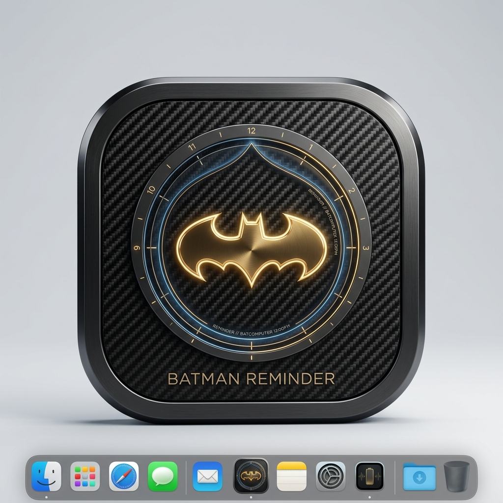
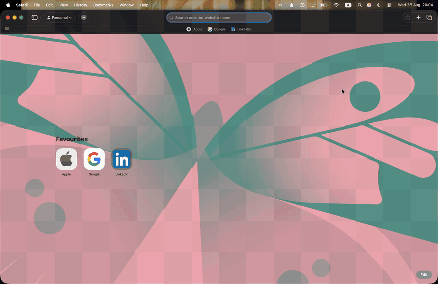

<div align="center">

  

  # 🦇 BATMAN REMINDER
  ### *The Batcomputer's Personal Hydration Protocol for macOS*

  <p align="center">
    <strong>Stay hydrated. Even in the darkest night.</strong><br />
    Because even the Dark Knight can't protect Gotham with a dehydration headache.
  </p>

  <p align="center">
    <a href="https://drive.google.com/file/d/17nPK4XWNVtFpvqt9_mEetUUNwzNr-NXz/view?usp=drive_link">
      
    </a>
    <a href="https://drive.google.com/file/d/1KNn-R_4OTjskQ5JlRN_RrJKWMEPt8AFQ/view?usp=drive_link">
      
    </a>
  </p>

  <p align="center">
    
    
    
    
    
    
  </p>

  ---

  ### ⚡ [DOWNLOAD APP](https://drive.google.com/file/d/17nPK4XWNVtFpvqt9_mEetUUNwzNr-NXz/view?usp=drive_link) &nbsp;•&nbsp; 📖 [RELEASE NOTES](https://drive.google.com/file/d/1KNn-R_4OTjskQ5JlRN_RrJKWMEPt8AFQ/view?usp=drive_link) &nbsp;•&nbsp; 🛡️ [INSTALLATION GUIDE](#-installation--first-run) &nbsp;•&nbsp; 👨‍💻 [CREATOR & STUDIO](#-architect--studio)

</div>

<br />

---

## 🎬 Live In Action

> When your interval hits, Batman physically rappels down from your macOS Menu Bar on a high-tension tactical grapple cable to enforce your hydration routine.

<div align="center">
  <kbd>
    
  </kbd>
</div>

<br />

---


## 🧠 Why Batman Reminder?

Most hydration apps feel like clinical medical trackers or annoying nagging push notifications that you instinctively swipe away. 

**Batman Reminder is built differently:**
* **You are in Gotham.** Deep focus sessions make you forget physical survival needs.
* **The Vigilante Protocol.** Batman doesn't ask twice — he drops directly onto your workspace, delivers his order, and vanishes back into the shadows once you log your water.
* **Zero Dock Clutter.** Built natively for macOS, it lives exclusively in the menu bar with negligible memory footprint.

```
┌──────────────────────────────────────────────────────────────┐
│  BATCOMPUTER TELEMETRY // HYDRATION PROTOCOL v1.0 ACTIVE     │
│  STATUS       : OPERATIONAL                                  │
│  TARGET       : OPTIMAL COGNITIVE PERFORMANCE                │
│  TACTICAL HUD : SILENT MENU-BAR MONITORING                   │
│  ALERTS       : DYNAMIC CABLE DESCENT OVERLAY                │
└──────────────────────────────────────────────────────────────┘
```

<br />

---

## ⚡ Tactical Features

### 🦇 Cinematic Menu-Bar Grapple Drop
* Batman rappels down smoothly from the top of your screen with precision animation and high-tension cable physics.
* Accompanied by Batcomputer acoustic sound cues to break you out of tunnel vision.

### 💧 Telemetry & Hydration Tracking
* Set your daily hydration target (from **2,000 ml** to **4,000 ml+**).
* Visual live-updating HUD displaying your daily progress percentage, remaining quota, and time till next reminder.

### ⏱️ Flexible Scheduling Protocols
* **Interval Mode:** Reminders drop every *30m, 45m, 60m, 90m*, or custom durations.
* **Fixed Time Mode:** Calibrate alerts to precise times during your shift.

### ⚡ Lightning-Fast Water Logging
* Log hydration in single clicks: `+250 ml`, `+500 ml`, `+750 ml`.
* Built-in hotkeys so you never lose your developer or creative flow state.

### 🔥 Hydration Streaks
* Gotham rewards relentless discipline.
* Build daily consecutive streaks and defend your record.

### 🌙 Stealth Mode & Ultra-Low Overhead
* Stays discreetly in the macOS Menu Bar.
* Consumes **<0.1% CPU** during idle. No bloated Electron containers — pure native speed.

### 🔒 100% Sovereign & Local Privacy
* Zero cloud dependencies. Zero telemetry. Zero trackers.
* Every drop logged is encrypted and stored strictly inside your local macOS sandbox.

<br />

---

## 🖥️ System Requirements

| Specification | Requirement |
| :--- | :--- |
| **Operating System** | macOS 14.0 Sonoma or macOS 15.0+ Sequoia |
| **Architecture** | Universal Binary (Apple Silicon M1 / M2 / M3 / M4 + Intel Core) |
| **Footprint** | Lightweight native binary (~sub-megabyte memory idling) |
| **Permissions** | Notification authorization + Accessibility / Screen Overlay |

<br />

---

## 🚀 Installation & First Run

### 1. Download
Grab the latest release bundle directly from Wayne Enterprises secure drive:
👉 **[Download Batman Reminder for macOS](https://drive.google.com/file/d/17nPK4XWNVtFpvqt9_mEetUUNwzNr-NXz/view?usp=drive_link)**

### 2. Launch
1. Open the downloaded archive / DMG.
2. Drag `Batman Reminder.app` into your **Applications** folder.
3. Launch `Batman Reminder` from Spotlight or Applications.

### 3. macOS Gatekeeper Notice ("Open Anyway")
Because Batman Reminder is an independent, non-AppStore native release, macOS Gatekeeper may prompt:
> *"Batman Reminder cannot be opened because the developer cannot be verified."*

**To authorize in 5 seconds:**
1. Open **System Settings** → **Privacy & Security**.
2. Scroll down to the **Security** section.
3. Click **"Open Anyway"** next to *Batman Reminder*.
4. Confirm by clicking **Open** — Gotham is now armed! 🦇

<br />

---

## 🎮 Interactive Controls & Quick Commands

| Action | Control | Result |
| :--- | :--- | :--- |
| **Menu Bar Icon** | `Click 🦇` | Reveals the Tactical Batcomputer HUD |
| **Quick Log +250ml** | `Button / Hotkey` | Adds 250ml & updates live HUD progress bar |
| **Snooze Protocol** | `Snooze 5m` | Postpones Batman's drop by 5 minutes |
| **Test Deployment** | `Test Drop` | Triggers immediate Batman drop animation |

<br />

---

## 🛠️ The Tech Arsenal

<div align="center">

```
  ┌─────────────────┐       ┌─────────────────┐       ┌─────────────────┐
  │   macOS AppKit  │ ───▶  │ Tactical Grapple│ ───▶  │   Batcomputer   │
  │   Menu Bar Host │       │ Cable Animation │       │   HUD Telemetry │
  └─────────────────┘       └─────────────────┘       └─────────────────┘
                                     │
                                     ▼
                            ┌─────────────────┐
                            │  Local Storage  │
                            │  100% Sandbox   │
                            └─────────────────┘
```

</div>

* **Engine:** Native macOS App Architecture
* **Interface & Showcase:** Modern CSS Glassmorphism, Dynamic Canvas Atmosphere Particles, Web Audio API Acoustic Engine
* **Aesthetics:** Wayne Yellow (`#F5C518`), Gotham Pitch Black (`#0A0A0C`), Carbon Fiber Glass

<br />

---

## 👨‍💻 Architect & Studio

<div align="center">

### Built with obsession by **Jay Dhokne**
### Powered by **3jaeen**

<br />

[](https://github.com/jayyy-zip)
[](https://www.linkedin.com/in/jay-dhokne-891a55290/)
[](https://www.instagram.com/j3y.zip/?hl=en)

<br />

<p align="center">
  <em>“It’s not who I am underneath, but what I drink that defines me.”</em>
</p>

</div>

<br />

---

## 🌟 Support & Feedback

If Batman Reminder helps you stay hydrated through long coding marathons and nocturnal work sessions:
* ⭐ **Star this repository** to signal the Bat-Signal across GitHub!
* 📣 Share it with your fellow Mac-wielding night owls.
* 🐛 Found a bug or have a tactical feature request? [Open an Issue](https://github.com/jayyy-zip/gothamreminder/issues).

<br />

<div align="center">
  <sub>© 2026 <strong>3jaeen</strong>. Developed & Designed by <strong>Jay Dhokne</strong>. Engineered for macOS. All Batman imagery & trademarks inspired by Wayne Enterprises.</sub>
</div>
